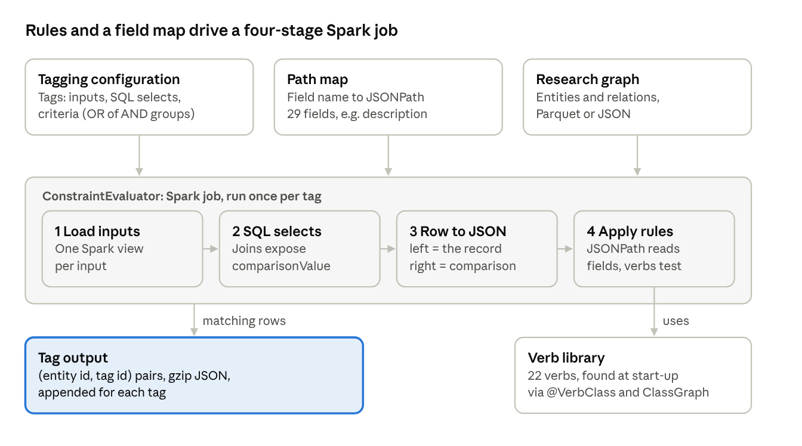
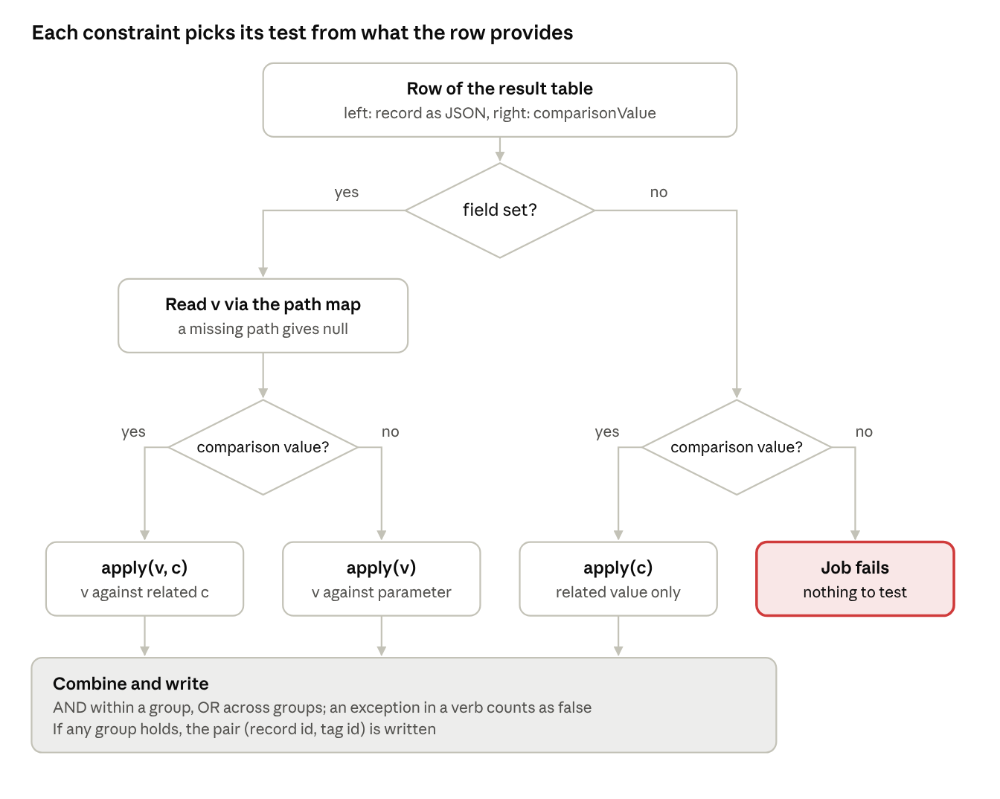

OSTrails DELIVERABLE 3.6: SKG Research Product Quality toolbox
==============================================================

.. page-authors::
    Paolo Manghi
    Miriam Baglioni
    Alessia Bardi
    Claudio Atzori

**Abstract** Metadata ingestion and curation processes are no longer the norm in Open Science workflows. Scientists publish publications, data, and software products in different venues from different disciplines, often solely driven by common sense rather than rigorous publishing workflows. Such unruled practices may harm the discoverability, access, monitoring, assessment, and reproducibility of science.

This deliverable introduces the SKG Research Product Quality Toolbox (hereafter, the Toolbox), a set of norms and tests designed to evaluate and enhance the quality of research product publishing workflows based on metadata analysis, and the Metadata Tagger, the software that runs the tests of the Toolbox on an SKG and attaches to each research product a tag for every test it triggers. The Toolbox exploits the structure of Scholarly Knowledge Graphs (SKGs), assuming products bear semantic links between them. These norms, based on the SKG-IF data model, are categorised as “mandatory”, establishing minimal conditions for basic discoverability and monitoring, and “recommended”, enabling accessibility, reproducibility, and enhanced discoverability. The Toolbox aims to capture best practices in providing metadata that maximises **FAIRness** (Findability, Accessibility, Interoperability, and Reusability) and supports robust research assessment across disciplinary domains. Examples of mandatory norms include the presence of a title, while recommended norms encompass the inclusion of Persistent Identifiers (PIDs) and abstracts. By defining these quality criteria, the Toolbox offers a mechanism to monitor and improve scholarly publishing workflows, ultimately contributing to a more reliable and transparent open science ecosystem.

Introduction
------------

Open Science publishing practices brought the recognition of diverse research outputs beyond traditional publications, and the introduction of publishing practices and venues beyond scientific publishers, such as data repositories, catch-all repositories, etc. Peer review is no longer the norm, and Green publishing, community endorsement, or simply commonsense, are recognised forms of publishing practices. More specifically, metadata curation is no longer the norm, as scientists are offered a variety of tools to ingest and update metadata upon submission or publishing of their results, often without any curation support. As a consequence, bibliographic metadata is produced by authors following heterogeneous practices, which often affect FAIRness, in terms of discoverability, accessibility, and reuse of scientific results, as well as research assessment practices, which suffer from unreliable or incomplete metadata information.

Scholarly Knowledge Graphs (SKGs) aggregate and offer access to metadata about research products and their relationships with other research-related entities, such as other products, authors, organisations, etc. By offering access to a window of metadata records across different disciplines, SKGs can serve as an observatory to identify researchers’ Open Science “bad” and “good” practices and patterns in providing metadata information during the publishing process.

The Toolbox consists of a set of “good norms” and related “tests”, which verify that records respect such norms. Norms are inspired by generic “rules of thumb”, which scientists should apply during the publishing process (e.g. completeness of metadata, usage of PIDs, etc.), and by misbehaviour patterns identified by analysing SKGs (e.g. cut and paste of abstracts in metadata for research article and supplemented dataset). By implementing such tests, SKGs can annotate research product metadata with references to the “violated” norms. Such annotated SKGs can be used for two main purposes:

-  Improving scholarly communication workflows: notifying scientists, communities of scientists, and publishing venues about the norms they are violating; for example, reporting to a data repository (i.e. a publishing venue) that authors are often missing the abstracts or links to publications;
-  Helping SKG consumers narrow down to the research products that respect good norms, or more generally the norms that matter to the consumer at hand; for example, calculating indicators for the research assessment of research performing organisations (RPOs) and researchers only using research products that match all good norms.

The Toolbox defines an agreed set of norms, steering good publishing practices, across the whole scholarly communication record. Unlike other metadata quality frameworks, the Toolbox aims to ensure that the whole graph of scholarly communication is as complete and coherent as possible, across individuals, research products, organisations, and communities.

In the following, we depict optimal publishing workflows for research publications, research data, and research software :footcite:`manghi2024challenges,gruenpeter2021defining,callaghan2019research,chavan2011datapaper`. Based on these, we draft an initial version of the Toolbox, which we keep populating and testing on a real SKG for the duration of the project.

Methodology
-----------

The Toolbox defines norms and tests inspired by “ideal publishing workflows” for research products. Norms describe good properties of metadata records, which reflect “good publishing practices” or, in some cases, prevent “bad practices” that may compromise the exploitation of the metadata representation of the scholarly communication record represented by a given SKG. Tests enable the detection of anomalies in research product metadata, which may compromise one or more of the norms. Examples are checking the presence of required properties, the correctness of formatting, and the consistency of metadata across the different entities and properties.

The Toolbox can be used across different SKGs as the reference for validation tools that implement its tests and analyse SKG metadata and relationships to identify which norms are not respected by the records; the Metadata Tagger, described in `Metadata Tagger Framework`_, is such a tool. The resulting annotated SKGs, which all refer to the same norms of the Toolbox, may bring an unprecedented added value:

-  **Identify research products with shortcomings** that may compromise their suitability for research assessment. This could include instances where data is published without proper licensing or a software product lacks a link to a repository.
-  **Provide recommendations to researchers and scientific communities** on how to improve publishing practices and encourage Open Science practices. For instance, researchers may be prompted to provide missing author details, links to data, to GitHub for software, or licensing information.
-  **Provide recommendations to publishing venues** on how to improve publishing processes. For instance, researchers relying on given data sources may miss key information, such as links to data and links to grants, because of inadequate UIs.
-  **Produce metrics of open science practice adherence** for data sources, venues, and communities. This allows for a transparent evaluation of the impact and quality of different actors involved in scholarly communication.
-  **Prevent patterns of misbehaviour** such as cut and paste of metadata properties of articles to speed up the mandatory deposition of research data.

By tracking such information, SKGs can serve as a valuable tool for improving the quality and trustworthiness of research outputs, promoting more effective and transparent research assessment practices. This promotes a culture of open science, where the focus is not only on the quantity of research produced, but also on its quality, accessibility, and reusability.

The reference data model of the Toolbox for research product metadata is the SKG-IF. Norms and tests use the names of the entities, properties, and relationships as defined at https://skg-if.github.io/interoperability-framework.

Optimal publishing workflows
----------------------------

Based on the sources cited above, an optimal, FAIR (Findable, Accessible, Interoperable, Reusable) publishing workflow for research publications, data, and software would incorporate several key elements to ensure high-quality, trustworthy, and easily accessible outputs. In the following, we detail some of the key elements and aspects that should be considered while publishing research products in a FAIR and reproducible manner.

Research publications publishing workflows
^^^^^^^^^^^^^^^^^^^^^^^^^^^^^^^^^^^^^^^^^^

The optimal publishing workflow for research papers, including software and data papers/articles, should also adhere to the FAIR principles (Findability, Accessibility, Interoperability, and Reusability), as well as ensuring scholarly rigour. The following phases can be identified:

**Publishing process:**

-  *Prepare Complete Metadata*: Populate all metadata properties with accurate information. This includes descriptions, authors and their ORCID identifiers (or other PIDs), affiliations and ROR.org identifiers (or other PIDs), funding details, and links to related data or software.
-  *Incorporate Data and Software Citations in the reference list*: If data or software are used or produced as part of the research, ensure that they are properly published (see sections below) and cited and linked in the text.
-  *Provide relationships in the metadata:* if the publishing process allows for this, provide relationships from the metadata to the related products. In particular, products that are created as an outcome of the scientific effort described in the paper should be linked to it with the relation ``is_supplemented_by`` (the publication is supplemented by the product).
-  *Submit the Paper to peer review*: Submit the paper through the journal's submission system (or via an open access repository; in this case, this phase corresponds to the “publishing” phase below) and provide all necessary metadata
-  *Publishing*: Ensure that the final publication, both print and online, includes all necessary links, PIDs, and supplementary information such as data and software, are published properly (see sections below).

**Ensuring scientific trust and reproducibility:**

-  *Peer Review*: Engage in the peer-review process to ensure the quality of the research and its documentation. This may be a pre-publication review, open review or post-publication review, or a combination of these approaches.
-  *Open Access*: Consider publishing the paper in an open access journal or making it available in a repository to improve its accessibility.
-  *Data and Software Availability*: Make data and software, when applicable, openly available alongside the paper to ensure reproducibility of results and build trust. Link them using appropriate relationships in the metadata. This is particularly important for software papers, which should provide direct links to the code or executable programs.
-  *Complete Metadata*: Provide all metadata required to unambiguously identify the authors and other contributors, the affiliations, and the context of the research.

Research data publishing workflows
^^^^^^^^^^^^^^^^^^^^^^^^^^^^^^^^^^

The optimal publishing workflow for research data should also adhere to the FAIR principles (Findability, Accessibility, Interoperability, and Reusability). We can identify the following phases:

**Planning and preparation:**

-  *Definition of FAIRification objectives*: Before publishing, establish clear objectives for making the data FAIR. This includes identifying the intended users, uses, lineage, provenance, funding (if any), and the required level of FAIRness.
-  *Choose an Appropriate Repository*: Select a “suitable data repository”. This could be a disciplinary repository or a generalist one. The repository should be able to handle the specific data types, formats and metadata requirements of your data.
-  *Metadata Analysis*: Examine existing metadata to identify what enhancements are needed to improve findability, accessibility or reusability of the data.
-  *Licence Selection*: Choose a clear, standard licence that specifies how the data can be reused.
-  *Creation of a DMP*: the DMP could act as a container of all the information required for data preparation.

**Publishing process:**

-  *Upload Data*: Upload the data to the chosen repository
-  *Add Complete Bibliographic Metadata*: Populate all metadata properties with accurate information. This includes descriptions, authors and their ORCID identifiers (or other PIDs), affiliations and ROR.org identifiers (or other PIDs), funding details, and links to related publications, software, or DMPs.
-  *If any, make use of community standards.*
-  *Specify Relationships*: Link data to related publications, code, or other resources. Use relations such as ``is_supplemented_by`` (from the publication to the dataset) or ``is_documented_by`` where appropriate.
-  *Mint a Persistent Identifier (PID)*: Obtain a PID (e.g., DOI, Handle) for the dataset, ensuring its long-term accessibility and citability.

**Ensuring scientific trust and reproducibility:**

-  *Community Review*: Where possible, seek community endorsement or peer review of the dataset
-  *Documentation*: Provide comprehensive documentation including methodology, interpretation guidance, and contact information. Data papers can be useful for providing human-readable documentation.
-  *Data Validation*: Consider implementing pre-publication validation procedures to assess the dataset's fitness for purpose. Support post-publication validation by allowing feedback on reuse of the data.
-  *Metadata Freezing*: Where possible freeze metadata at the point of publication to prevent malicious changes (e.g. adding citations, adding authors).

Research software publishing workflows
^^^^^^^^^^^^^^^^^^^^^^^^^^^^^^^^^^^^^^

An optimal publishing workflow for research software should prioritise Findability, Accessibility, Interoperability, and Reusability (FAIR) principles. The following key phases can be identified:

**Planning and preparation:**

-  *Choose an Appropriate Repository*: Select a dedicated software repository designed for research software, if possible. These repositories are better equipped to handle the specific metadata needs of software compared to generic versioning platforms. If a dedicated software repository is unavailable, use a data or institutional repository while being careful to correctly identify and describe the software.
-  *Prepare Complete Metadata*: Populate all metadata properties with accurate information. This includes descriptions, authors and their ORCID identifiers (or other PIDs), affiliations and ROR.org identifiers (or other PIDs), funding details, and links to related publications (or data). The title should be descriptive and not a copy of the title of an associated publication or the name of a GitHub repository.
-  *Include CFF or codemeta Files*: Create a Citation File Format (CFF) or codemeta file within the software repository to ensure that attribution metadata is included with the software.
-  *Licence Selection*: Choose a clear, standard, open-source licence that allows for reuse and collaboration.

**Publishing process:**

-  *Upload Software*: Upload the software, including all relevant code, scripts, and executables, to the chosen repository.
-  *Provide a Valid Repository URL*: Ensure that the URL to the software repository is provided and syntactically correct.
-  *Add Complete Metadata*: Populate all metadata properties with accurate information. This includes descriptions, authors and their ORCID identifiers (or other PIDs), affiliations and ROR.org identifiers (or other PIDs), funding details, and links to related publications. Titles and descriptions should not be copies of an associated publication, as identified in many cases.
-  *Specify Relationships to other products*: Use relations such as ``is_supplemented_by`` (from the publication to the software) or ``is_documented_by`` to link publications with the software. If the software is derived from other software or code, also link to the progenitor code.
-  *Mint a Persistent Identifier (PID)*: Obtain a PID (e.g. DOI, Software Heritage ID) for the software. The Software Heritage ID is particularly useful for software. The URL to the software repository can also act as a stable identifier.

**Ensuring scientific trust and reproducibility:**

-  *Community Review*: If possible, submit the software for peer or community review to ensure its quality and trustworthiness.
-  *Documentation*: Provide documentation for the software and, where possible, reference from the software metadata a publication or technical report that describes the software.
-  *Link to Publications*: Ensure clear links to any publications that use, cite or describe the software.
-  *Metadata Freezing*: Where possible, freeze metadata at the point of publication, including the use of metadata files in the same repository as the software.

Research Product Quality Toolbox
--------------------------------

In this section we present the norms and tests of the Toolbox in three tables. The first table includes norms that apply to all kinds of research products, while the other two gather specific ones for datasets and software; no norm specific to publications has been identified. The last column of each table names the tag of the Metadata Tagger that implements the test. The tables refer to the SKG-IF data model where properties and relationships are specified. Supplements are expressed by the relation ``is_supplemented_by`` in *related_products*, which links a publication to the dataset or software that supplements it.

Each table differentiates between norms that are “mandatory” or “recommended”, where:

-  *Mandatory*: norms that establish minimal conditions for publications, data, and software metadata to satisfy use cases of basic discoverability; examples are the presence of a title for every product, and of at least one author for software, while publications and research data without authors are admitted.
-  *Recommended*: norms that, if respected, enable accessibility and reproducibility patterns or enhance discoverability; examples are: the presence of PIDs, or Software Heritage ID for software; for datasets, the presence of a link to the article that they are supplementing.

Norms are not expected to recommend the adoption and validation of one specific vocabulary or data format, as they should be applicable to any SKG. They are intended to capture good intent and behaviour in providing metadata that maximises FAIRness, reproducibility, and research assessment across disciplinary domains. For instance, commonly expected norms include the presence of a title for all products, or at least one author for research software, while “no authors” could be admitted for publications and research data. Examples of recommended, but not mandatory, criteria are the presence of PIDs and abstracts or, for datasets, the presence of an ``is_supplemented_by`` relation from the article they supplement. For software products, a good practice of reproducibility could entail recommending the inclusion of a URL to a software repository (e.g., GitHub reference) or referencing a publication product that documents the software, such as an article or a technical report.

Finally, where a match exists, all norms have been associated with quality criteria as specified by the FAIR Data principles :footcite:`gofair_fair_principles` and the FAIR Research Software principles :footcite:`moraw2024practical,barker2022fair4rs`.

Publishing norms for all kinds of products
^^^^^^^^^^^^^^^^^^^^^^^^^^^^^^^^^^^^^^^^^^

SKG-IF product_type = literature, research data, research software, other
"""""""""""""""""""""""""""""""""""""""""""""""""""""""""""""""""""""""""

+-----------------------+-------------------------------------------+-------------------------------------------------------------------------------------------------------------------------------------------------+-------------------------------------------------------------------------------------------------------------------------------------------------------------------------------+--------------------------+---------+
| **SKG-IF properties** | **Recommended norm**                      | **Mandatory norm**                                                                                                                              | **Test**                                                                                                                                                                      | **Validation framework** | **Tag** |
+=======================+===========================================+=================================================================================================================================================+===============================================================================================================================================================================+==========================+=========+
| *titles*              |                                           | Products should have a title                                                                                                                    | Verify the presence of at least one value for *titles*                                                                                                                        | FAIR-F2; FAIR4RS-F2      | MTI     |
+-----------------------+-------------------------------------------+-------------------------------------------------------------------------------------------------------------------------------------------------+-------------------------------------------------------------------------------------------------------------------------------------------------------------------------------+--------------------------+---------+
| *identifiers*         | One of the identifiers should be a PID    |                                                                                                                                                 | Verify that the value for *scheme* is part of the list of schemes in SKG-IF                                                                                                   | FAIR-F1                  | NP      |
|                       |                                           |                                                                                                                                                 |                                                                                                                                                                               |                          |         |
| *scheme*              |                                           |                                                                                                                                                 |                                                                                                                                                                               | FAIR4RS-F3               |         |
+-----------------------+-------------------------------------------+-------------------------------------------------------------------------------------------------------------------------------------------------+-------------------------------------------------------------------------------------------------------------------------------------------------------------------------------+--------------------------+---------+
| *contributions*       | Agents of type “person” should have a PID |                                                                                                                                                 | Verify that the *identifiers* / *scheme* of each agent in *contributions* / *by* is part of the list of PID schemes in SKG-IF; products without contributions are not checked | FAIR-F2; FAIR4RS-F2      | AP      |
|                       |                                           |                                                                                                                                                 |                                                                                                                                                                               |                          |         |
| *by*                  |                                           |                                                                                                                                                 |                                                                                                                                                                               |                          |         |
+-----------------------+-------------------------------------------+-------------------------------------------------------------------------------------------------------------------------------------------------+-------------------------------------------------------------------------------------------------------------------------------------------------------------------------------+--------------------------+---------+
| *abstracts*           | Products should have an abstract          |                                                                                                                                                 | Verify the presence of at least one value for *abstracts*                                                                                                                     | FAIR-F2; FAIR4RS-F2      | MA      |
+-----------------------+-------------------------------------------+-------------------------------------------------------------------------------------------------------------------------------------------------+-------------------------------------------------------------------------------------------------------------------------------------------------------------------------------+--------------------------+---------+
| *manifestations*      |                                           | Publication date should be provided                                                                                                             | Verify that at least one value for *publication* is provided                                                                                                                  | FAIR-F2; FAIR4RS-F2      | DA      |
|                       |                                           |                                                                                                                                                 |                                                                                                                                                                               |                          |         |
| *dates*               |                                           |                                                                                                                                                 |                                                                                                                                                                               |                          |         |
|                       |                                           |                                                                                                                                                 |                                                                                                                                                                               |                          |         |
| *publication*         |                                           |                                                                                                                                                 |                                                                                                                                                                               |                          |         |
+-----------------------+-------------------------------------------+-------------------------------------------------------------------------------------------------------------------------------------------------+-------------------------------------------------------------------------------------------------------------------------------------------------------------------------------+--------------------------+---------+
| *manifestations*      |                                           | Products should have at least one manifestation, with one valid reference to a data source entry from which the product files can be downloaded | Verify the presence of at least one value for *identifiers* in the manifestations                                                                                             | FAIR-A1                  | MID     |
|                       |                                           |                                                                                                                                                 |                                                                                                                                                                               |                          |         |
| *identifiers*         |                                           |                                                                                                                                                 |                                                                                                                                                                               | FAIR4RS-A1               |         |
|                       |                                           |                                                                                                                                                 |                                                                                                                                                                               |                          |         |
| *scheme* / *value*    |                                           |                                                                                                                                                 |                                                                                                                                                                               |                          |         |
+-----------------------+-------------------------------------------+-------------------------------------------------------------------------------------------------------------------------------------------------+-------------------------------------------------------------------------------------------------------------------------------------------------------------------------------+--------------------------+---------+
| *manifestations*      |                                           | Provenance of a product should be clearly specified                                                                                             | Verify the presence of a value for *biblio* / *hosting_data_source* in the manifestations                                                                                     | FAIR-R1.2                | HD      |
|                       |                                           |                                                                                                                                                 |                                                                                                                                                                               |                          |         |
| *biblio*              |                                           |                                                                                                                                                 |                                                                                                                                                                               | FAIR4RS-R1.2             |         |
|                       |                                           |                                                                                                                                                 |                                                                                                                                                                               |                          |         |
| *hosting_data_source* |                                           |                                                                                                                                                 |                                                                                                                                                                               |                          |         |
+-----------------------+-------------------------------------------+-------------------------------------------------------------------------------------------------------------------------------------------------+-------------------------------------------------------------------------------------------------------------------------------------------------------------------------------+--------------------------+---------+
| *manifestations*      | Products should have a licence            |                                                                                                                                                 | Verify the presence of a value for *licence* in the manifestations                                                                                                            | FAIR-F2; FAIR4RS-F2      | MIL     |
|                       |                                           |                                                                                                                                                 |                                                                                                                                                                               |                          |         |
| *licence*             |                                           |                                                                                                                                                 |                                                                                                                                                                               | FAIR-R1.1                |         |
+-----------------------+-------------------------------------------+-------------------------------------------------------------------------------------------------------------------------------------------------+-------------------------------------------------------------------------------------------------------------------------------------------------------------------------------+--------------------------+---------+
| *funding*             |                                           | A product should not be published before the start of the grants that fund it                                                                   | Verify that the value for *dates* / *publication* is later than the *duration* / *start* of each grant in *funding*                                                           | FAIR-R1.2                | PB      |
|                       |                                           |                                                                                                                                                 |                                                                                                                                                                               |                          |         |
| grant *duration*      |                                           |                                                                                                                                                 |                                                                                                                                                                               | FAIR4RS-R1.2             |         |
|                       |                                           |                                                                                                                                                 |                                                                                                                                                                               |                          |         |
| *start*               |                                           |                                                                                                                                                 |                                                                                                                                                                               |                          |         |
+-----------------------+-------------------------------------------+-------------------------------------------------------------------------------------------------------------------------------------------------+-------------------------------------------------------------------------------------------------------------------------------------------------------------------------------+--------------------------+---------+

Publishing norms for publications
^^^^^^^^^^^^^^^^^^^^^^^^^^^^^^^^^

SKG-IF product_type = literature
""""""""""""""""""""""""""""""""

No norms specific for literature products have been identified.

Publishing norms for datasets
^^^^^^^^^^^^^^^^^^^^^^^^^^^^^

SKG-IF product_type = research data
"""""""""""""""""""""""""""""""""""

+-----------------------+----------------------------------------------------------------------------------------------------------------+-----------------------------------------------------------------------+--------------------------------------------------------------------------------------------------------------------------------------------------------------------------------------+--------------------------+---------+
| **SKG-IF properties** | **Recommended norm**                                                                                           | **Mandatory norm**                                                    | **Test**                                                                                                                                                                             | **Validation framework** | **Tag** |
+=======================+================================================================================================================+=======================================================================+======================================================================================================================================================================================+==========================+=========+
| *titles*              | Titles should be meaningful and key to find the dataset - Should not be generated by machinery                 |                                                                       | Verify that values for *titles* do not match values from a list of repeating titles. Examples are “Supplementary material for paper X”, “Figure X for paper Z”, “Data from: paper K” | FAIR-F2; FAIR4RS-F2      | SM      |
+-----------------------+----------------------------------------------------------------------------------------------------------------+-----------------------------------------------------------------------+--------------------------------------------------------------------------------------------------------------------------------------------------------------------------------------+--------------------------+---------+
|                       | Titles should be meaningful and key to find the dataset - Should not be a copy of literature’s title           |                                                                       | Verify that the values for *titles* do not match the *titles* of the publication that lists the product in its *related_products* / *is_supplemented_by* (if any)                    | FAIR-F2; FAIR4RS-F2      | MT      |
+-----------------------+----------------------------------------------------------------------------------------------------------------+-----------------------------------------------------------------------+--------------------------------------------------------------------------------------------------------------------------------------------------------------------------------------+--------------------------+---------+
| *abstracts*           | Abstracts should be meaningful and key to find the dataset - Should not be a copy of the literature’s abstract |                                                                       | Verify that the values for *abstracts* do not match the *abstracts* of the publication that lists the product in its *related_products* / *is_supplemented_by* (if any)              | FAIR-F2; FAIR4RS-F2      | DMA     |
+-----------------------+----------------------------------------------------------------------------------------------------------------+-----------------------------------------------------------------------+--------------------------------------------------------------------------------------------------------------------------------------------------------------------------------------+--------------------------+---------+
|                       |                                                                                                                | Abstracts must be present if no publication is related to the dataset | Verify that a value for *abstracts* is present when no publication lists the product in its *related_products* / *is_supplemented_by*                                                | FAIR-F2; FAIR4RS-F2      | DWA     |
+-----------------------+----------------------------------------------------------------------------------------------------------------+-----------------------------------------------------------------------+--------------------------------------------------------------------------------------------------------------------------------------------------------------------------------------+--------------------------+---------+
| *manifestations*      | A licence should be provided for datasets                                                                      |                                                                       | Verify the presence of a value for *licence* in the manifestations                                                                                                                   | FAIR-F2; FAIR4RS-F2      | MIL     |
|                       |                                                                                                                |                                                                       |                                                                                                                                                                                      |                          |         |
| *licence*             |                                                                                                                |                                                                       |                                                                                                                                                                                      | FAIR-R1.1                |         |
+-----------------------+----------------------------------------------------------------------------------------------------------------+-----------------------------------------------------------------------+--------------------------------------------------------------------------------------------------------------------------------------------------------------------------------------+--------------------------+---------+
| *related_products*    | Datasets should benefit from a description of their creation, nature, or usage in a related document           |                                                                       | Verify that the product is listed in the *related_products* / *is_supplemented_by* of a product with *product_type* literature                                                       | FAIR-F2; FAIR4RS-F2      | RL      |
|                       |                                                                                                                |                                                                       |                                                                                                                                                                                      |                          |         |
| *is_supplemented_by*  |                                                                                                                |                                                                       |                                                                                                                                                                                      |                          |         |
+-----------------------+----------------------------------------------------------------------------------------------------------------+-----------------------------------------------------------------------+--------------------------------------------------------------------------------------------------------------------------------------------------------------------------------------+--------------------------+---------+

Publishing norms for software
^^^^^^^^^^^^^^^^^^^^^^^^^^^^^

SKG-IF product_type = research software
"""""""""""""""""""""""""""""""""""""""

+-----------------------+-----------------------------------------------------------------------------------------------------------------+------------------------------------------------------------------------+------------------------------------------------------------------------------------------------------------------------------------------------------------------------------------------+--------------------------+---------+
| **SKG-IF properties** | **Recommended norm**                                                                                            | **Mandatory norm**                                                     | **Test**                                                                                                                                                                                 | **Validation framework** | **Tag** |
+=======================+=================================================================================================================+========================================================================+==========================================================================================================================================================================================+==========================+=========+
| *identifiers*         | One of the identifiers should be a Software Heritage ID, ensuring the software is being preserved               |                                                                        | Verify that one of the entries in *identifiers* has the *scheme* ``swhid`` (Software Heritage ID)                                                                                        | FAIR-F1                  | MSID    |
|                       |                                                                                                                 |                                                                        |                                                                                                                                                                                          |                          |         |
| *scheme*              |                                                                                                                 |                                                                        |                                                                                                                                                                                          | FAIR4RS-F3               |         |
+-----------------------+-----------------------------------------------------------------------------------------------------------------+------------------------------------------------------------------------+------------------------------------------------------------------------------------------------------------------------------------------------------------------------------------------+--------------------------+---------+
| *contributions*       |                                                                                                                 | Software should have at least one author                               | Verify the presence of at least one value in *contributions* with *role* author                                                                                                          | FAIR4RS-F2               | MAU     |
|                       |                                                                                                                 |                                                                        |                                                                                                                                                                                          |                          |         |
| *role*                |                                                                                                                 |                                                                        |                                                                                                                                                                                          | FAIR4RS-R1.2             |         |
+-----------------------+-----------------------------------------------------------------------------------------------------------------+------------------------------------------------------------------------+------------------------------------------------------------------------------------------------------------------------------------------------------------------------------------------+--------------------------+---------+
| *titles*              | Titles should be meaningful and key to find the software - Should not be generated by machinery                 |                                                                        | Verify that the values for *titles* are not generic labels, such as “Software in GitHub” or “Source code release”                                                                        | FAIR-F2; FAIR4RS-F2      | MT2     |
+-----------------------+-----------------------------------------------------------------------------------------------------------------+------------------------------------------------------------------------+------------------------------------------------------------------------------------------------------------------------------------------------------------------------------------------+--------------------------+---------+
|                       | Titles should be meaningful and key to find the software - Should not be a copy of literature’s title           |                                                                        | Verify that the values for *titles* do not match the *titles* of the publication that lists the product in its *related_products* / *is_supplemented_by* (if any)                        | FAIR-F2; FAIR4RS-F2      | MT      |
+-----------------------+-----------------------------------------------------------------------------------------------------------------+------------------------------------------------------------------------+------------------------------------------------------------------------------------------------------------------------------------------------------------------------------------------+--------------------------+---------+
|                       | Titles should be meaningful and key to find the software - Title should not be a copy of GitHub’s title         |                                                                        | Verify that the value for *titles* does not match a structure *xxxxxx/yyyyyy*                                                                                                            | FAIR-F2; FAIR4RS-F2      | MT3     |
+-----------------------+-----------------------------------------------------------------------------------------------------------------+------------------------------------------------------------------------+------------------------------------------------------------------------------------------------------------------------------------------------------------------------------------------+--------------------------+---------+
| *abstracts*           | Abstracts should be meaningful and key to find the software - Should not be a copy of the literature’s abstract |                                                                        | Verify that the values for *abstracts* do not match the *abstracts* of the publication that lists the product in its *related_products* / *is_supplemented_by* (if any)                  | FAIR-F2; FAIR4RS-F2      | DMA     |
+-----------------------+-----------------------------------------------------------------------------------------------------------------+------------------------------------------------------------------------+------------------------------------------------------------------------------------------------------------------------------------------------------------------------------------------+--------------------------+---------+
|                       |                                                                                                                 | Abstracts must be present if no publication is related to the software | Verify that a value for *abstracts* is present when no publication lists the product in its *related_products* / *is_supplemented_by*                                                    | FAIR-F2; FAIR4RS-F2      | DWA     |
+-----------------------+-----------------------------------------------------------------------------------------------------------------+------------------------------------------------------------------------+------------------------------------------------------------------------------------------------------------------------------------------------------------------------------------------+--------------------------+---------+
| *manifestations*      | Software products should provide a link to a software repository                                                |                                                                        | Verify that at least one manifestation has an *identifiers* entry with *scheme* url pointing to a software repository platform (GitHub, GitLab, Bitbucket, Software Heritage, bio.tools) | FAIR-F2; FAIR4RS-F2      | SWR     |
|                       |                                                                                                                 |                                                                        |                                                                                                                                                                                          |                          |         |
| *identifiers*         |                                                                                                                 |                                                                        |                                                                                                                                                                                          | FAIR4RS-F3               |         |
|                       |                                                                                                                 |                                                                        |                                                                                                                                                                                          |                          |         |
| *scheme* / *value*    |                                                                                                                 |                                                                        |                                                                                                                                                                                          |                          |         |
+-----------------------+-----------------------------------------------------------------------------------------------------------------+------------------------------------------------------------------------+------------------------------------------------------------------------------------------------------------------------------------------------------------------------------------------+--------------------------+---------+
| *manifestations*      | A licence should be provided for software                                                                       |                                                                        | Verify the presence of a value for *licence* in the manifestations                                                                                                                       | FAIR-F2; FAIR4RS-F2      | MIL     |
|                       |                                                                                                                 |                                                                        |                                                                                                                                                                                          |                          |         |
| *licence*             |                                                                                                                 |                                                                        |                                                                                                                                                                                          | FAIR-R1.1                |         |
|                       |                                                                                                                 |                                                                        |                                                                                                                                                                                          |                          |         |
|                       |                                                                                                                 |                                                                        |                                                                                                                                                                                          | FAIR4RS-R1.1             |         |
+-----------------------+-----------------------------------------------------------------------------------------------------------------+------------------------------------------------------------------------+------------------------------------------------------------------------------------------------------------------------------------------------------------------------------------------+--------------------------+---------+
| *related_products*    | Software should benefit from a description of their creation, nature, or usage in a related document            |                                                                        | Verify that the product is listed in the *related_products* / *is_supplemented_by* of a product with *product_type* literature                                                           | FAIR-F2; FAIR4RS-F2      | RL      |
|                       |                                                                                                                 |                                                                        |                                                                                                                                                                                          |                          |         |
| *is_supplemented_by*  |                                                                                                                 |                                                                        |                                                                                                                                                                                          |                          |         |
+-----------------------+-----------------------------------------------------------------------------------------------------------------+------------------------------------------------------------------------+------------------------------------------------------------------------------------------------------------------------------------------------------------------------------------------+--------------------------+---------+

Metadata Tagger Framework
-------------------------

The Toolbox defines what to check: norms, and the tests that verify them. The Metadata Tagger (hereafter, the tagger) is the software that runs those checks: it implements each test of the Toolbox as a tag and attaches tags to research products, whatever compatible data model describes them. The examples in this deliverable use the results and the data model of the OpenAIRE Graph, but the tagger can be configured for other inputs. The tagger does not compute a quality score. Each tag records one observable property of a record, such as a missing abstract, a dataset title copied from its article, or a software deposit on Software Heritage; quality is then expressed as the combination of the tags a record carries, and no single tag determines it on its own. The following sections show how the tests of the Toolbox were turned into executable rules and how the tagger evaluates them. The main results reported here are:

-  **A rule engine on Apache Spark 4.0.2** (Java 17, about 2,340 lines of code, published as eu.dnetlib.dhp:qualitytagger in the D-Net repository) that evaluates any number of tags over the full graph in one run.
-  **A declarative rule language.** Tags, their inputs, optional SQL joins and their constraints are written in JSON; a separate path map ties logical field names to locations in the record. Changing a policy requires no recompilation.
-  **A library of 22 verbs**, the building blocks of constraints: existence, equality, containment, prefix, regular expression, numeric and date comparison, and two higher-order verbs that apply another verb over the elements of a list.
-  **A catalogue of 20 tags** covering publications, datasets, software and other research products, in 51 tag definitions.

Context: from quality criteria to tags
^^^^^^^^^^^^^^^^^^^^^^^^^^^^^^^^^^^^^^

The tagger turns quality criteria written for people into rules a machine can evaluate over hundreds of millions of records, and it deliberately stops at observation.

Origin of the checks
""""""""""""""""""""

The Toolbox, presented in `Research Product Quality Toolbox`_, defines a set of publishing **norms** for research products, derived from optimal publishing workflows for publications, data and software. Each norm:

-  is expressed on the SKG-IF data model (for example *manifestations* / *licence* or *related_products* / *is_supplemented_by*);
-  is either mandatory, a minimal condition for basic discoverability and monitoring, or recommended, a condition that enables accessibility, reproducibility and better discoverability;
-  is mapped, where a match exists, to the FAIR Data and FAIR4RS principles;
-  comes with a test and with the tag that implements it.

The tagger implements those tests as tags; the norm tables of the Toolbox name, for each norm, the tag that tests it. Because the OpenAIRE Graph is not stored in SKG-IF, the tagger, its configuration and the rest of this part use the names of the OpenAIRE Graph. The SKG-IF names of the norm tables correspond to them as follows:

-  the product types literature, research data, research software and other are the OpenAIRE entities ``publication``, ``dataset``, ``software`` and ``otherresearchproduct``;
-  *manifestations* are the ``instance`` objects of a result;
-  *related_products* / *is_supplemented_by* is the relation ``IsSupplementedBy`` of the ``relation`` table, from a publication to the product that supplements it;
-  *funding* is the relation ``isProducedBy`` from a result to a ``project``, and the grant *duration* / *start* is the project's ``startDate``;
-  *manifestations* / *dates* / *publication* is read at record level, from ``dateofacceptance``;
-  *manifestations* / *biblio* / *hosting_data_source* is the ``hostedby`` of each instance.

Why a tagger and not a scorer
"""""""""""""""""""""""""""""

A single property rarely settles whether a record is good. A dataset without an abstract is weak in isolation but acceptable if it is clearly linked to the article it supplements; a software record with a generic title is much less of a problem if it is deposited on Software Heritage. Fixing weights inside the engine would hard-code one view of quality for every user and every use.

Quality assessment therefore has two layers, and the tagger covers only the first:

#. **Observation (the tagger).** Each tag is a boolean, reproducible fact about one record, computed from the graph. Tags are independent: none reads another's result.
#. **Interpretation (downstream).** A quality profile is a combination of tags: a record is read through the set of tags it carries, and through the tags it does not carry. Different consumers (graph curators, content providers, funders, monitoring dashboards) can combine the same tags in different ways, as the Toolbox foresees: notifying researchers and publishing venues, restricting an indicator to products that respect a chosen set of norms, or measuring the adherence of data sources and communities.

Tags fall into three kinds of signal, which only acquire meaning in combination. The kind of signal says what a tag tells about a record; whether the tag marks a violation or a compliance is a separate matter, explained in `How to read a tag`_.

+----------+---------------------------------------------------------------------------------------------+--------------------------------------------------------------------------------------------------------------------------------------+
| Kind     | Meaning                                                                                     | Examples                                                                                                                             |
+==========+=============================================================================================+======================================================================================================================================+
| Gap      | A piece of metadata expected by the criteria is missing or unusable                         | MA (no abstract), MTI (no title), NP (no recognised PID), AP (an author without identifier), MAU (software without authors)          |
+----------+---------------------------------------------------------------------------------------------+--------------------------------------------------------------------------------------------------------------------------------------+
| Strength | The record goes beyond the minimum                                                          | MT and DMA (title or abstract written for the product), SWR (software in a code repository)                                          |
+----------+---------------------------------------------------------------------------------------------+--------------------------------------------------------------------------------------------------------------------------------------+
| Context  | A property that describes what the record is, and changes how the other tags should be read | SM (dataset that is supplementary material), RL (dataset linked to an article), DWA (dataset with abstract and no linked literature) |
+----------+---------------------------------------------------------------------------------------------+--------------------------------------------------------------------------------------------------------------------------------------+

The same record can carry several tags of each kind.

How to read a tag
"""""""""""""""""

The Toolbox describes annotated graphs as carrying references to the norms a record violates. Most tags work that way. For five tags, however, the condition was simpler to express positively, so the tag marks the records that **satisfy** the norm. Within the eligible population, the records without the tag are the ones that violate it.

======================== ==================================================================== ================================
Tag marks                Tags                                                                 How to find the violations
======================== ==================================================================== ================================
Violation of the norm    MA, DA, MTI, NP, AP, HD, MPID, MID, MIL, PB, SM, MSID, MAU, MT2, MT3 The tagged records
Compliance with the norm MT, DMA, DWA, RL, SWR                                                Eligible records without the tag
======================== ==================================================================== ================================

Read together, tags describe a record better than any one of them. A dataset tagged SM and RL but not DMA has a title generated by machinery, is linked to the article it supplements, and copies that article's abstract: three norms observed at once, whose weight depends on the use.

Objectives and scope
^^^^^^^^^^^^^^^^^^^^

The objective is to provide a tool able to tag a general research product with the set of quality tags it is associated with. So that the implementation never has to change, the tagger comes with configurable properties, which describe both the tag and the part of the research product to inspect to verify the tag itself. All the examples in this document, and the tests that come with the delivered software, use the OpenAIRE Graph as the input model.

The design goals that follow from it:

-  **Declarative rules.** Domain experts write and revise checks in JSON; developers only extend the verb library when a new kind of test is needed.
-  **Independence from the data model.** The tagger is not bound to any predefined data model. The path map says where the information to verify lives in the record, and the constraint says how to verify it, so the same tagger can be used on any input.
-  **Cross-entity checks.** Rules can compare a record with related entities (its project, the article it supplements) through Spark SQL joins over the graph's relations.
-  **Scale.** Evaluation is distributed row by row with Spark; inputs are read as Parquet, falling back to JSON.
-  **Composable output.** The result is a flat list of (record id, tag id) pairs that downstream services join with the graph and combine into quality profiles.

In scope: the engine, the configuration format, the verb library and the tag catalogue.

Out of scope: the combination of tags into quality profiles or indicators, which belongs to downstream services; the presentation of tags to users; and the value transformations ("actions") that the path map format can declare but this engine does not execute.

System architecture
^^^^^^^^^^^^^^^^^^^

The tagger is a single Spark application driven by two configuration files: the tagging configuration says what to check, the path map says where each field lives in a record.

.. _fig-architecture:

   Metadata Tagger architecture · 3 inputs, 4 stages, 1 output

For each tag, the job loads its inputs, runs the optional SQL selections, serialises every row to JSON and tests it with verbs from the library; matching records are written as (record id, tag id) pairs.

Configuration model
^^^^^^^^^^^^^^^^^^^

A run is driven by two JSON files: the **tagging configuration**, which lists the tags and their rules, and the **path map**, which tells the engine where each logical field lives in a record. Both are parsed with Gson into the classes of the ``model`` package.

The tagging configuration
"""""""""""""""""""""""""

The file holds a single object with a ``tags`` array (``TaggingConstraints``). Each element is a tag (``TaggingConstraint``) with these keys:

=============== ===================================== ======== ============================================================================================
Key             Type                                  Required Role
=============== ===================================== ======== ============================================================================================
``id``          string                                yes      Tag identifier written in the output (e.g. ``MA``, ``PB``)
``inputs``      object, name → path                   yes      Graph tables to load; each name becomes a Spark SQL view
``selects``     array of ``{tableName, tableSelect}`` no       SQL statements run in order, each registered as a new view; used for joins and pre-filtering
``resultTable`` string                                yes      The view whose rows are evaluated (an input or a select)
``criteria``    array of constraint groups            no       The rule; if absent, every row of ``resultTable`` is tagged
``entityToTag`` string                                no       Documents which entity type is tagged; not used by the engine
=============== ===================================== ======== ============================================================================================

When ``selects`` is present, the result table must expose a column named ``comparisonValue``. It carries the value taken from the related entity (a project start date, the title of the supplemented article). A select that needs no comparison still declares it, as ``CAST(NULL AS STRING) AS comparisonValue`` (see DWA).

Criteria, constraint groups and constraints
"""""""""""""""""""""""""""""""""""""""""""

``criteria`` is a disjunction of conjunctions. Each element is a constraint group (``Constraints``) holding a ``constraint`` array; a record is tagged when at least one group has all its constraints satisfied.

.. math::

   tag(r) \Leftrightarrow \bigvee_{g \in criteria} \; \bigwedge_{a \in g} verb(a, r)

This form is enough to express every check in the catalogue. Alternatives become separate groups (the ten title prefixes of SM are ten groups of one constraint); joint conditions share a group (MID and AP require two constraints at once).

Each constraint (``Constraint``) has five keys:

============= ===============================================================================================================================================================
Key           Meaning
============= ===============================================================================================================================================================
``verb``      Name of the test to apply, resolved in the verb library (e.g. ``not_exist_forall``)
``field``     Path-map key of the value to test in the record (e.g. ``description``). If null, the verb tests the comparison value from the joined entity instead
``value``     Parameter of the verb: null, a string, or a list of strings (accepted PID schemes, a regular expression, title prefixes)
``jsonPath``  Optional. Path-map key of a second path, applied inside each element of ``field`` when ``field`` is a list of objects (e.g. the PID schemes inside each author)
``applyVerb`` Only for ``forall_apply`` and ``forany_apply``: the verb to apply to each element
============= ===============================================================================================================================================================

Three constraints from the tagging configuration show the range of the format:

.. code:: json

   {"verb": "not_exist", "field": "description", "value": null}

   {"verb": "not_exist_forall", "field": "authorWhole", "jsonPath": "authorPids",
    "value": ["orcid", "orcid_pending", "github", "lattes", "…", "zbmath"]}

   {"verb": "exist", "field": null, "value": ["Article"]}

The first tags a record whose abstract list is empty. The second walks every author, reads the schemes of that author's PIDs, and tags the record unless every author has PIDs from the accepted list; AP pairs it with ``exist(author)``, so that records without authors are not checked. The third, used by RL, has no ``field``: it tests the comparison value taken from the related publication, and tags the dataset when every instance type of that publication is ``Article``.

The path map
""""""""""""

The path map (``ProtoMap``) is an object from logical names to ``{path, action?}``. ``path`` is a Jayway JSONPath expression evaluated on the record serialised as JSON. The delivered map defines 29 names for the OpenAIRE result schema; the key ``id`` is mandatory because it is read to write the output. The table lists the names used by the tag catalogue, and ``orcid`` as an example of a filter.

================================ ============================================================================ ===========================================================
Name                             JSONPath                                                                     Returns
================================ ============================================================================ ===========================================================
``id``                           ``$['id']``                                                                  The record identifier
``description``                  ``$['description'][*]['value']``                                             List of abstracts
``title``                        ``$['title'][*]['value']``                                                   List of titles
``publicationDate``              ``$['dateofacceptance'].value``                                              A date string, ``yyyy-MM-dd``
``pidScheme``                    ``$['pid'][*]['qualifier']['classid']``                                      Schemes of the record's PIDs (also reused inside instances)
``author``                       ``$['author'][*]['fullname']``                                               Names of all authors
``authorWhole``                  ``$['author']``                                                              List of author objects
``authorPids``                   ``$['pid'][*]['qualifier'].classid``                                         Applied inside an author: that author's PID schemes
``instance``                     ``$['instance'][*]``                                                         List of instance objects
``instanceAlternateIdentifiers`` ``$['alternateIdentifier'][*]['value']``                                     Applied inside an instance: its alternate identifiers
``instancePids``                 ``$['pid'][*]['value']``                                                     Applied inside an instance: the values of its PIDs
``instanceLicence``              ``$['license']['value']``                                                    Applied inside an instance: its licence
``instanceUrl``                  ``$['url']``                                                                 Applied inside an instance: its URLs
``hostedby``                     ``$['instance'][*]['hostedby']['value']``                                    Hosting data sources of all instances
``orcid``                        ``$['author'][*]['pid'][*][?(@['qualifier']['classid']=='orcid')]['value']`` ORCID iDs of all authors
================================ ============================================================================ ===========================================================

Some names are meant to be read on a whole record, others only inside an element reached through ``jsonPath`` (``authorPids``, ``instanceAlternateIdentifiers``, ``instancePids``, ``instanceLicence``, ``instanceUrl``). The engine does not distinguish them; the configuration author chooses which role a name plays.

An entry may also declare an ``action`` (class, method, parameters), for example to cut a date down to its year. Actions are parsed but not executed in this version.

Independence from the data model
""""""""""""""""""""""""""""""""

The engine has no knowledge of the data model it reads. Everything that depends on the model sits in the two configuration files:

-  **Where the information is:** the path map binds each logical field to a JSONPath expression in the record.
-  **How to verify it:** the constraints name a verb, a field and a parameter, without referring to the model.
-  **Which entities and relations to read:** the ``inputs`` and the SQL ``selects`` of each tag.

The tagger can therefore run on any input that Spark can read as Parquet or JSON, provided the path map defines an ``id`` field. Moving the same tags to another model, for instance SKG-IF instead of the OpenAIRE Graph, means rewriting the path map and, for cross-entity tags, the SQL selects that name the model's tables and columns. The code, the verb library and the constraints stay the same.

This is the main design property of the tagger: the implementation is written once, and new models, new tags and new norms are added through configuration only.

Constraint semantics
^^^^^^^^^^^^^^^^^^^^

A verb is a small Java class that decides one constraint. Its behaviour depends on three things: the shape of the value read from the record, the shape of its parameter, and whether a comparison value from a related entity is present.

How a verb is built
"""""""""""""""""""

Every verb implements the ``Selection`` interface, which has two methods:

-  ``apply(value)`` tests the value read from the record against the verb's parameter.
-  ``apply(value, otherEntityValue)`` tests it against a value taken from a related entity, through the ``comparisonValue`` column.

Verbs carry an annotation, ``@VerbClass("not_exist")``. When the configuration is loaded, ``VerbResolver`` scans the ``criteria`` package with ClassGraph, builds a map from names to classes, and instantiates each constraint's verb through its one-argument constructor, passing the constraint's ``value`` as parameter. Two optional interfaces extend a verb: ``JsonPathAware`` verbs receive the constraint's ``jsonPath``; ``ApplyOtherVerbAware`` verbs receive its ``applyVerb``. Adding a verb therefore means writing one annotated class; no registry needs editing.

Value shapes
""""""""""""

A JSONPath read returns one of three shapes, and every verb is written to handle the ones that make sense for it:

-  **A string**, for a definite path such as ``$['dateofacceptance'].value``.
-  **A list**, for any path with a wildcard or a filter (``[*]``, ``[?(…)]``). It may be empty, and its elements may be strings or whole objects (authors, instances).
-  **Null**, when the path does not exist in the record.

A value counts as empty when it is null, an empty string, or a list whose elements are all null or empty strings. Lists of strings are compared element by element; equality on identifiers and schemes is case-insensitive in ``exist``, case-sensitive in ``equals``.

Verb reference
""""""""""""""

In the table, *v* is the value read from the record, *p* the constraint's parameter and *c* the comparison value from the related entity.

+----------------------------------------------------+-----------------------------+-----------------------------------------------------------------------------------------------------------------------------------------------------+------------------------------------------------------------------------------------+
| Verb                                               | Parameter *p*               | ``apply(v)``: true when…                                                                                                                            | ``apply(v, c)``: true when…                                                        |
+====================================================+=============================+=====================================================================================================================================================+====================================================================================+
| ``exist``                                          | null or list of strings     | *p* null: *v* is not empty. *v* a string: *v* equals one entry of *p* (case-insensitive). *v* a list: it is not empty and every element is in *p*   | *v* (a string) equals *c*, or one element of *c*, after trimming, case-insensitive |
+----------------------------------------------------+-----------------------------+-----------------------------------------------------------------------------------------------------------------------------------------------------+------------------------------------------------------------------------------------+
| ``not_exist``                                      | as ``exist``                | ``exist`` is false                                                                                                                                  | never                                                                              |
+----------------------------------------------------+-----------------------------+-----------------------------------------------------------------------------------------------------------------------------------------------------+------------------------------------------------------------------------------------+
| ``exist_forall``                                   | as ``exist``                | *v* is a non-empty list and every element passes ``exist``, applied inside the element through ``jsonPath`` if set                                  | every element of *v* passes ``exist`` against *c*                                  |
+----------------------------------------------------+-----------------------------+-----------------------------------------------------------------------------------------------------------------------------------------------------+------------------------------------------------------------------------------------+
| ``not_exist_forall``                               | as ``exist``                | ``exist_forall`` is false, including when *v* is empty                                                                                              | ``exist_forall`` against *c* is false                                              |
+----------------------------------------------------+-----------------------------+-----------------------------------------------------------------------------------------------------------------------------------------------------+------------------------------------------------------------------------------------+
| ``equals``                                         | string or one-element list  | *v* (string or one-element list) equals *p*, case-sensitive                                                                                         | never                                                                              |
+----------------------------------------------------+-----------------------------+-----------------------------------------------------------------------------------------------------------------------------------------------------+------------------------------------------------------------------------------------+
| ``equals_caseinsensitive``                         | as ``equals``               | as ``equals``, ignoring case                                                                                                                        | never                                                                              |
+----------------------------------------------------+-----------------------------+-----------------------------------------------------------------------------------------------------------------------------------------------------+------------------------------------------------------------------------------------+
| ``not_equals``, ``not_equals_caseinsensitive``     | as ``equals``               | the corresponding ``equals`` is false                                                                                                               | never                                                                              |
+----------------------------------------------------+-----------------------------+-----------------------------------------------------------------------------------------------------------------------------------------------------+------------------------------------------------------------------------------------+
| ``not_equals_forall``                              | string                      | no element of *v* equals *p* (trimmed, ignoring case)                                                                                               | never                                                                              |
+----------------------------------------------------+-----------------------------+-----------------------------------------------------------------------------------------------------------------------------------------------------+------------------------------------------------------------------------------------+
| ``contains``                                       | string or list              | *v* string, *p* string: *v* contains *p*. *v* string, *p* list: *v* contains every entry. *v* list: some element contains *p*, or some entry of *p* | never                                                                              |
+----------------------------------------------------+-----------------------------+-----------------------------------------------------------------------------------------------------------------------------------------------------+------------------------------------------------------------------------------------+
| ``contains_caseinsensitive``                       | as ``contains``             | as ``contains``, ignoring case                                                                                                                      | never                                                                              |
+----------------------------------------------------+-----------------------------+-----------------------------------------------------------------------------------------------------------------------------------------------------+------------------------------------------------------------------------------------+
| ``not_contains``, ``not_contains_caseinsensitive`` | as ``contains``             | the corresponding ``contains`` is false                                                                                                             | never                                                                              |
+----------------------------------------------------+-----------------------------+-----------------------------------------------------------------------------------------------------------------------------------------------------+------------------------------------------------------------------------------------+
| ``starts_with``                                    | one string                  | *v* (string or one-element list) starts with *p*, case-sensitive                                                                                    | never                                                                              |
+----------------------------------------------------+-----------------------------+-----------------------------------------------------------------------------------------------------------------------------------------------------+------------------------------------------------------------------------------------+
| ``starts_with_caseinsensitive``                    | string or list              | some element of *v* starts with some entry of *p*, ignoring case                                                                                    | never                                                                              |
+----------------------------------------------------+-----------------------------+-----------------------------------------------------------------------------------------------------------------------------------------------------+------------------------------------------------------------------------------------+
| ``apply_regexp``                                   | regular expression          | *v*, or some element of *v*, matches *p* in full                                                                                                    | never                                                                              |
+----------------------------------------------------+-----------------------------+-----------------------------------------------------------------------------------------------------------------------------------------------------+------------------------------------------------------------------------------------+
| ``greater_than``, ``lesser_than``                  | one value                   | *v* (string, integer, or one-element list) is greater or less than *p*; strings compare lexicographically                                           | never                                                                              |
+----------------------------------------------------+-----------------------------+-----------------------------------------------------------------------------------------------------------------------------------------------------+------------------------------------------------------------------------------------+
| ``before``, ``after``                              | date ``yyyy-MM-dd`` or null | the date *v* is before or after *p*                                                                                                                 | the date *v* is before or after the date *c*; if *c* is null, falls back to *p*    |
+----------------------------------------------------+-----------------------------+-----------------------------------------------------------------------------------------------------------------------------------------------------+------------------------------------------------------------------------------------+
| ``forall_apply``                                   | parameter of ``applyVerb``  | *v* is a non-empty list and ``applyVerb`` holds for every element (on the sub-value at ``jsonPath`` if set)                                         | every element of *v* passes ``exist`` against *c*                                  |
+----------------------------------------------------+-----------------------------+-----------------------------------------------------------------------------------------------------------------------------------------------------+------------------------------------------------------------------------------------+
| ``forany_apply``                                   | parameter of ``applyVerb``  | *v* is a non-empty list and ``applyVerb`` holds for at least one element                                                                            | as ``forall_apply``                                                                |
+----------------------------------------------------+-----------------------------+-----------------------------------------------------------------------------------------------------------------------------------------------------+------------------------------------------------------------------------------------+

Errors and missing data
"""""""""""""""""""""""

A verb that receives a shape it cannot handle (a list of two where one value is expected, a date in another format, a missing ``applyVerb``) throws an exception. The ``Constraint`` wrapper catches every exception and returns false. The consequences are worth knowing when writing rules:

-  A **negated verb** that fails does not become true: ``not_equals`` on an unusable value returns false, not true.
-  A **missing path** reaches the verb as null; ``not_exist`` treats it as empty and is satisfied, while ``before`` throws and is not.
-  A **sub-path missing inside one element** (an instance without licence) makes that element fail ``exist``; for ``exist_forall`` the whole list then fails, so ``not_exist_forall`` tags the record.

The effect is conservative for positive verbs and permissive for the negations of ``exist`` and ``exist_forall``, which are those used to detect gaps.

Evaluation dynamics
^^^^^^^^^^^^^^^^^^^

A run evaluates tags one after another; within a tag, every row of the result table is checked independently on the Spark executors, and only matching rows produce output.

On the driver
"""""""""""""

#. **Arguments.** The command line is read as ``--name value`` pairs; ``pathMapPath``, ``taggingPath`` and ``outputPath`` are expected.
#. **Configuration.** Both files are read through the file system and parsed with Gson.
#. **Verb binding.** For each tag, a ``VerbResolver`` is created and every constraint receives its verb instance, built with the constraint's ``value`` and, where relevant, its ``jsonPath`` name and ``applyVerb``.
#. **Sequential tags.** Tags are processed in the order of the file. Each tag triggers its own Spark jobs; there is no state shared between tags other than the output directory.

For each tag
""""""""""""

#. **Inputs.** Each entry of ``inputs`` is read as Parquet and, if that fails, as JSON, and registered as a temporary view under its name. A later tag that uses the same name replaces the view, so tags can point the same name at different paths.
#. **Selections.** The ``selects`` statements run in order; each may read the views registered before it. Typical uses are joining a result with related entities through ``relation`` and dropping records marked ``deletedbyinference``.
#. **Row serialisation.** The engine reads the columns of ``resultTable`` and builds a query that adds two columns: ``left``, the whole row except ``comparisonValue`` as a JSON string, and ``right``, the comparison value wrapped as ``{"comparisonValue": …}`` (null when the tag has no selects).
#. **Row evaluation.** A ``map`` over the rows applies the criteria to (``left``, ``right``), as shown below; groups are tried in order and stop at the first that holds, constraints in a group stop at the first that fails.
#. **Output.** A matching row yields a (record id, tag id) pair, where the record id is read from ``left`` with the path map's ``id`` entry; the pairs are written as gzip JSON in append mode to ``outputPath``.

Inside one row
""""""""""""""

For each constraint, the engine first resolves its ``jsonPath`` name through the path map and hands the resulting JSONPath to the verb. It then decides which of the verb's two methods to call, depending on what the row provides.

.. _fig-row-evaluation:

   Per-row evaluation of one constraint · 4 outcomes

When ``field`` is set, the field value *v* is read from the record and the verb compares it either with the related entity's value *c* or, when there is none, with its own parameter. When ``field`` is null, the constraint is about the related entity only: the verb tests *c*. Two configuration errors stop the job rather than a single row: a ``field`` that the path map does not define, and a constraint with neither ``field`` nor comparison value.

Consequences of the join model
""""""""""""""""""""""""""""""

A join produces one row per related entity, so the same record can be evaluated several times within a tag. Two effects follow:

-  **Existential reading of cross-entity tags.** PB tags a publication if its date precedes the start of *at least one* of its projects; RL tags a dataset if *at least one* supplemented publication satisfies the rule.
-  **Duplicate pairs.** A record matching on several related rows is written once per row. Consumers should treat the output as a set and deduplicate the (record id, tag id) pairs.

When a tag declares ``CAST(NULL AS STRING) AS comparisonValue``, the serialised ``right`` holds no value; reading it fails and is logged as a warning for every row before the engine falls back to ``apply(v)``. The result is correct, but the logs grow with the size of the table.

Tag catalogue
^^^^^^^^^^^^^

The catalogue lists the 20 tags of the tagging configuration. A tag keeps the same identifier on every product type it applies to, so that each norm is tested by one tag: the configuration holds 51 tag definitions, one for each pair of tag and product type. The output pairs carry the record identifier and the tag, not the product type, which is read from the graph.

The column "Tagged when" states the exact condition implemented, derived from the configuration and the verb semantics above.

All product types
"""""""""""""""""

These tags implement the norms that apply to all kinds of products and are defined on publications, datasets, software and other research products.

+-----+-----------+---------------------------------------------------------------------------------------------------------+----------------------------------------------------------------------------------------------------------------------------------------------------------------------------------------------------------------------------------+
| Tag | Marks     | Rule                                                                                                    | Tagged when                                                                                                                                                                                                                      |
+=====+===========+=========================================================================================================+==================================================================================================================================================================================================================================+
| MA  | Violation | ``not_exist(description)``                                                                              | No non-empty abstract                                                                                                                                                                                                            |
+-----+-----------+---------------------------------------------------------------------------------------------------------+----------------------------------------------------------------------------------------------------------------------------------------------------------------------------------------------------------------------------------+
| DA  | Violation | ``not_exist(publicationDate)``                                                                          | No date of acceptance at record level                                                                                                                                                                                            |
+-----+-----------+---------------------------------------------------------------------------------------------------------+----------------------------------------------------------------------------------------------------------------------------------------------------------------------------------------------------------------------------------+
| MTI | Violation | ``not_exist(title)``                                                                                    | No non-empty title                                                                                                                                                                                                               |
+-----+-----------+---------------------------------------------------------------------------------------------------------+----------------------------------------------------------------------------------------------------------------------------------------------------------------------------------------------------------------------------------+
| NP  | Violation | ``not_exist(pidScheme, [10 schemes])``; for software, 11 schemes including ``swhid``                    | The record has no PID, or has a PID whose scheme is outside DOI, PMID, PMC, PMCID, ARK, OMID, Crossref, OpenAlex, arXiv, Handle (and SWHID for software)                                                                         |
+-----+-----------+---------------------------------------------------------------------------------------------------------+----------------------------------------------------------------------------------------------------------------------------------------------------------------------------------------------------------------------------------+
| AP  | Violation | ``exist(author)`` AND ``not_exist_forall(authorWhole, jsonPath authorPids, [20 schemes])``              | The record has at least one author, and at least one author has no PID or a PID outside the 20 accepted author schemes (ORCID, ORCID pending, ISNI, DBLP, ResearcherID, VIAF and others). Records without authors are not tagged |
+-----+-----------+---------------------------------------------------------------------------------------------------------+----------------------------------------------------------------------------------------------------------------------------------------------------------------------------------------------------------------------------------+
| HD  | Violation | ``not_exist_forall(hostedby)``                                                                          | No instance declares a hosting data source, or one is empty                                                                                                                                                                      |
+-----+-----------+---------------------------------------------------------------------------------------------------------+----------------------------------------------------------------------------------------------------------------------------------------------------------------------------------------------------------------------------------+
| MID | Violation | ``not_exist_forall(instance, alternate identifiers)`` AND ``not_exist_forall(instance, instance PIDs)`` | Some instance has no alternate identifier and some instance has no PID                                                                                                                                                           |
+-----+-----------+---------------------------------------------------------------------------------------------------------+----------------------------------------------------------------------------------------------------------------------------------------------------------------------------------------------------------------------------------+
| MIL | Violation | ``not_exist_forall(instance, jsonPath instanceLicence)``                                                | At least one instance declares no licence                                                                                                                                                                                        |
+-----+-----------+---------------------------------------------------------------------------------------------------------+----------------------------------------------------------------------------------------------------------------------------------------------------------------------------------------------------------------------------------+
| PB  | Violation | Join product ``isProducedBy`` project; ``before(publicationDate, c = project start date)``              | The date of acceptance precedes the start date of at least one funding project                                                                                                                                                   |
+-----+-----------+---------------------------------------------------------------------------------------------------------+----------------------------------------------------------------------------------------------------------------------------------------------------------------------------------------------------------------------------------+

Publications
""""""""""""

MPID is defined on publications only.

+------+-----------+------------------------------------------------------------------+------------------------------------------------------------+
| Tag  | Marks     | Rule                                                             | Tagged when                                                |
+======+===========+==================================================================+============================================================+
| MPID | Violation | ``not_exist_forall(instance, jsonPath pidScheme, [10 schemes])`` | At least one instance has no PID from the accepted schemes |
+------+-----------+------------------------------------------------------------------+------------------------------------------------------------+

Datasets
""""""""

The tags that compare a product with literature use ``IsSupplementedBy`` relations whose source is a publication and whose target is the product. Deleted-by-inference records are excluded on both sides.

+-----+------------+-------------------------------------------------------------------------------------------------------------------------+-------------------------------------------------------------------------------------------------------------------------------------------------------------------------------------------------------------------------+
| Tag | Marks      | Rule                                                                                                                    | Tagged when                                                                                                                                                                                                             |
+=====+============+=========================================================================================================================+=========================================================================================================================================================================================================================+
| SM  | Violation  | 10 groups of ``starts_with_caseinsensitive(title, prefix)``                                                             | A title starts with "supplementary material(s) for", "supplementary file for", "supplementary document for", "supplementary figure", "supplemental figure", "supplementary table", "figure", "table for" or "data from" |
+-----+------------+-------------------------------------------------------------------------------------------------------------------------+-------------------------------------------------------------------------------------------------------------------------------------------------------------------------------------------------------------------------+
| MT  | Compliance | Join with the supplemented publication; ``not_exist_forall(title)`` against c = the publication's titles                | At least one dataset title differs from every title of the publication. Datasets with no title are not tagged                                                                                                           |
+-----+------------+-------------------------------------------------------------------------------------------------------------------------+-------------------------------------------------------------------------------------------------------------------------------------------------------------------------------------------------------------------------+
| DMA | Compliance | As MT, on ``description``                                                                                               | At least one dataset abstract differs from every abstract of the publication. Datasets with no abstract are not tagged                                                                                                  |
+-----+------------+-------------------------------------------------------------------------------------------------------------------------+-------------------------------------------------------------------------------------------------------------------------------------------------------------------------------------------------------------------------+
| RL  | Compliance | Join with the supplemented publication; ``exist(field null, ["Article"])`` on c = the publication's instance types      | The dataset supplements a publication whose instances are all of type Article                                                                                                                                           |
+-----+------------+-------------------------------------------------------------------------------------------------------------------------+-------------------------------------------------------------------------------------------------------------------------------------------------------------------------------------------------------------------------+
| DWA | Compliance | Datasets not targeted by any ``IsSupplementedBy`` from a valid publication (``LEFT ANTI JOIN``); ``exist(description)`` | The dataset has an abstract and no linked literature                                                                                                                                                                    |
+-----+------------+-------------------------------------------------------------------------------------------------------------------------+-------------------------------------------------------------------------------------------------------------------------------------------------------------------------------------------------------------------------+

Software
""""""""

MT, DMA, RL and DWA use the same rules as for datasets, with the software table in place of the dataset table.

+------+------------+---------------------------------------------------------------------------------------------+-------------------------------------------------------------------------------------------------------------------------------------------------------------------------------------------------------------------------------------------------------------------------------------+
| Tag  | Marks      | Rule                                                                                        | Tagged when                                                                                                                                                                                                                                                                         |
+======+============+=============================================================================================+=====================================================================================================================================================================================================================================================================================+
| MSID | Violation  | ``not_exist(pidScheme, ["swhid"])``                                                         | The software has no PID, or has a PID whose scheme is not SWHID                                                                                                                                                                                                                     |
+------+------------+---------------------------------------------------------------------------------------------+-------------------------------------------------------------------------------------------------------------------------------------------------------------------------------------------------------------------------------------------------------------------------------------+
| MAU  | Violation  | ``not_exist(author)``                                                                       | The software has no author                                                                                                                                                                                                                                                          |
+------+------------+---------------------------------------------------------------------------------------------+-------------------------------------------------------------------------------------------------------------------------------------------------------------------------------------------------------------------------------------------------------------------------------------+
| MT2  | Violation  | ``apply_regexp(title, generic-title pattern)``                                              | The whole title is a generic label: "software" or "code" on, in, from or at GitHub, GitLab or Bitbucket anywhere in the title; a title starting with "GitHub software", "(source) code release" or "source code" followed by ":", "for" or "of"; a title ending with "release vX.Y" |
+------+------------+---------------------------------------------------------------------------------------------+-------------------------------------------------------------------------------------------------------------------------------------------------------------------------------------------------------------------------------------------------------------------------------------+
| MT3  | Violation  | ``apply_regexp(title, owner/name pattern)``                                                 | A title has the form of a repository path, such as ``openaire/dnet-hadoop``                                                                                                                                                                                                         |
+------+------------+---------------------------------------------------------------------------------------------+-------------------------------------------------------------------------------------------------------------------------------------------------------------------------------------------------------------------------------------------------------------------------------------+
| SWR  | Compliance | ``forany_apply(instance, jsonPath instanceUrl, starts_with_caseinsensitive, [8 prefixes])`` | An instance URL starts with a GitHub, GitLab, Bitbucket, Software Heritage or bio.tools address                                                                                                                                                                                     |
+------+------------+---------------------------------------------------------------------------------------------+-------------------------------------------------------------------------------------------------------------------------------------------------------------------------------------------------------------------------------------------------------------------------------------+
| MT   | Compliance | As for datasets, on software                                                                | At least one software title differs from every title of the publication. Software with no title is not tagged                                                                                                                                                                       |
+------+------------+---------------------------------------------------------------------------------------------+-------------------------------------------------------------------------------------------------------------------------------------------------------------------------------------------------------------------------------------------------------------------------------------+
| DMA  | Compliance | As for datasets, on software                                                                | At least one software abstract differs from every abstract of the publication                                                                                                                                                                                                       |
+------+------------+---------------------------------------------------------------------------------------------+-------------------------------------------------------------------------------------------------------------------------------------------------------------------------------------------------------------------------------------------------------------------------------------+
| RL   | Compliance | As for datasets, on software                                                                | The software supplements a publication whose instances are all of type Article                                                                                                                                                                                                      |
+------+------------+---------------------------------------------------------------------------------------------+-------------------------------------------------------------------------------------------------------------------------------------------------------------------------------------------------------------------------------------------------------------------------------------+
| DWA  | Compliance | As for datasets, on software                                                                | The software has an abstract and no linked literature                                                                                                                                                                                                                               |
+------+------------+---------------------------------------------------------------------------------------------+-------------------------------------------------------------------------------------------------------------------------------------------------------------------------------------------------------------------------------------------------------------------------------------+

Notes on the implemented conditions
"""""""""""""""""""""""""""""""""""

-  **NP and MSID** use ``not_exist`` with a list, which is true when *any* scheme falls outside the list. A publication with a DOI and one non-listed identifier is therefore tagged NP, and a software with a SWHID and a DOI is tagged MSID. Tagging only records with no listed scheme needs a verb that is true only when no scheme is in the list, which the library does not yet provide.
-  **AP** checks only records with at least one author. Authors are required only for software, where their absence is tagged MAU; publications, datasets and other research products without authors receive neither tag.
-  **MID and MIL** tag a record as soon as *one* instance falls short, even if others are complete.
-  **RL** looks only at ``IsSupplementedBy`` and requires every instance of the publication to be of type Article.
-  **HD** in the tagging configuration tags missing hosting sources only; the configuration used by its test also tags "Unknown Repository" hosts.
-  **MT2** matches the whole title against a set of generic labels. "iNitro-Tyr software on github" and "Software from GitHub: GridSPN" are tagged, while "samtools", "A repository of protein structures" and "CoastNet (v2.1)" are not. Repository paths such as ``openaire/dnet-hadoop`` are left to MT3, and the length of a title is not checked, so short software names are not penalised.
-  **MT3** matches the whole title against ``[A-Za-z0-9_.-]+/[A-Za-z0-9_.-]+``. A title such as ``openaire/dnet-hadoop`` is tagged, while "A/B testing framework for X" is not; a title such as ``v1.2/release`` is tagged as well.
-  **SWR** marks compliance rather than violation, because the verb library has no verb that holds when no element starts with a given prefix. Software without the tag violates the norm.
-  **MPID** tests PIDs at instance level, a check that has no corresponding norm in the Toolbox.

Tags shared by several product types are configured once per type, with the same identifier and criteria, and with the input and selects of the corresponding table.

Build, deployment and usage
^^^^^^^^^^^^^^^^^^^^^^^^^^^

The tagger is a Maven project (``qualitytagger``) that builds one shaded JAR, run with ``spark-submit`` on a cluster or locally, or inside the provided Docker image.

Technology stack
""""""""""""""""

================ ============================ ================================================================
Component        Version                      Role
================ ============================ ================================================================
Java             17                           Language level
Apache Spark SQL 4.0.2 (Scala 2.13), provided Distributed reading, joins, writing
Jayway JSON-Path 2.4.0                        Field extraction from records
Gson             2.2.2                        Parsing of configuration files
Jackson Databind 2.18.2, provided             List parsing inside verbs
ClassGraph       4.8.71                       Discovery of verb classes
JUnit Jupiter    5.6.1                        Tests
Maven Shade      3.6.2                        Single runnable JAR; Guava relocated to avoid clashes with Spark
================ ============================ ================================================================

Build
"""""

.. code:: bash

   mvn clean package             # build and run the tests
   mvn clean package -DskipTests # build only
   mvn test                      # run the tests only

Run
"""

================= ======================================================
Argument          Content
================= ======================================================
``--pathMapPath`` Path map file
``--taggingPath`` Tagging configuration file
``--outputPath``  Directory where (record id, tag id) pairs are appended
================= ======================================================

.. code:: bash

   spark-submit --master "local[*]" \
     --class it.cnr.isti.qualitytagger.ConstraintEvaluator \
     target/qualitytagger-1.0.0-SNAPSHOT.jar \
     --pathMapPath /path/to/pathMap \
     --taggingPath /path/to/taggingConf \
     --outputPath /path/to/output/

All paths are resolved through the Hadoop file system of the Spark session, so local paths and HDFS paths both work.

Docker
""""""

The Dockerfile builds the JAR in a ``maven:3.9-eclipse-temurin-17`` stage and copies it into an ``apache/spark:4.0.2`` image, as ``/opt/spark/qualitytagger-1.0.0-SNAPSHOT.jar``. Configuration and data are mounted from the host:

.. code:: bash

   docker build -t qualitytagger:1.0.0 .

   docker run --rm -it \
     -v ./src:/opt/spark/work-dir/src \
     -v ./output:/opt/spark/work-dir/output \
     qualitytagger:1.0.0 /opt/spark/bin/spark-submit \
     --master "local[*]" \
     --class it.cnr.isti.qualitytagger.ConstraintEvaluator \
     /opt/spark/qualitytagger-1.0.0-SNAPSHOT.jar \
     --taggingPath ./src/test/resources/it/cnr/isti/qualitytagger/publicationprojectbefore/taggingConf \
     --pathMapPath ./src/test/resources/it/cnr/isti/qualitytagger/pathMap \
     --outputPath ./output/

The example runs tag PB on the test sample and writes its results to ``./output`` on the host.

Output
""""""

The output directory contains gzip-compressed JSON lines with two fields, ``_1`` (record identifier) and ``_2`` (tag id):

.. code:: json

   {"_1": "50|doi_________::063c7d157e255e750eecd8d87b365ef8", "_2": "PB"}

Writes are in append mode: several tags, or several runs, can share one directory. A new release should start from an empty directory to avoid mixing results.

Testing and validation
^^^^^^^^^^^^^^^^^^^^^^

Two test suites run the real Spark job (``ConstraintEvaluator.main``) in a local Spark session and check which records come out tagged.

``ConstraintEvaluatorJobTest`` checks each rule in isolation. Every rule has its own folder under ``src/test/resources`` with its configuration and a hand-checked sample of the OpenAIRE Graph entities it needs: publications only for single-entity tags, publications, relations and projects or datasets for cross-entity tags. All results go to one temporary output directory, and each test filters it by its own tag id.

==== ============================== ======================== =========
Tag  Test                           Expected tagged records  Assertion
==== ============================== ======================== =========
PB   PublicationBeforeProjectTest   2, checked by identifier Yes
MA   NotExistAbstractTest           2, checked by identifier Yes
DA   NotExistPublicationDateTest    2, checked by identifier Yes
MT2  SoftwareMinTitleTest           2, checked by identifier Yes
AP   NotExistAuthorPidTest          11                       Yes
MPID NotExistInstancePidTest        8                        Yes
NP   NotExistResultPidTest          7                        Yes
DWA  AbstractNoRelLiteratureTest    7                        Yes
SM   SupplementaryMaterialTest      2                        Yes
MT   MeaningfulTitleTest            2                        Yes
RL   AssociatedLiteratureTest       2                        Yes
DMA  MeaningfulAbstractTest         2                        Yes
HD   NotExistHostedByTest           3, checked by identifier Yes
MID  NotExistInstanceIdentifierTest 5, checked by identifier Yes
MIL  NotExistInstancelicenceTest    6, checked by identifier Yes
SWR  SoftwareRepoUrlTest            3, checked by identifier Yes
==== ============================== ======================== =========

The HD test configuration also tags instances hosted by "Unknown Repository", which accounts for one of its three records.

``FakeGraphTaggingTest`` runs the complete tagging configuration, with the 51 tag definitions used in production, on a fake graph of 8 publications, 10 datasets, 21 software, 3 other research products, one project and 12 relations. Each fake record starts from a complete record and changes a single property, so that every expected tag has one reason, written next to its assertion. The suite asserts the exact set of records tagged by each of the 20 tags, checks that complete records receive no tag, and checks that the run produces only the configured tag identifiers. The fake graph and its configuration are generated by ``src/test/python/make_fakegraph.py``, which holds the tag definitions once and also writes the production configuration.

Neither suite covers the error paths (a field missing from the path map, a constraint with neither field nor comparison value).

Examples
--------

The examples below show, on concrete records, how the tagger computes the tags of the catalogue and how the tags can be combined downstream. Records, identifiers and figures are illustrative.

Example 1: a tag definition
^^^^^^^^^^^^^^^^^^^^^^^^^^^

Tag PB tests the mandatory norm on *funding* / grant *duration* / *start*:

.. code:: json

   {
     "id": "PB",
     "inputs": {
       "publication": "./src/test/resources/it/cnr/isti/qualitytagger/graph/publication",
       "relation":    "./src/test/resources/it/cnr/isti/qualitytagger/graph/relation",
       "project":     "./src/test/resources/it/cnr/isti/qualitytagger/graph/project"
     },
     "selects": [{
       "tableName": "result",
       "tableSelect": "SELECT publication.*, project.startDate.value AS comparisonValue FROM publication JOIN relation JOIN project ON publication.id = relation.source AND project.id = relation.target WHERE relation.relClass = 'isProducedBy'"
     }],
     "entityToTag": "publication",
     "resultTable": "result",
     "criteria": [{"constraint": [{"verb": "before", "field": "publicationDate", "value": null}]}]
   }

For each (publication, project) row, the tagger reads ``publicationDate`` through the path map (``$['dateofacceptance'].value``) and compares it with the project start date in ``comparisonValue``. A publication accepted on 2023-05-12, produced by a project started on 2024-01-01, is written as ``{"_1": "50|example_____::p1", "_2": "PB"}``.

Example 2: from metadata to tags
^^^^^^^^^^^^^^^^^^^^^^^^^^^^^^^^

Publication P (excerpt) is produced by a project started on 2024-01-01 and is supplemented by dataset D:

.. code:: json

   {
     "id": "50|example_____::p1",
     "title": [{"value": "Deep learning for coastal erosion forecasting"}],
     "description": [{"value": "We present a model that forecasts coastal erosion from satellite data..."}],
     "dateofacceptance": {"value": "2023-05-12"},
     "pid": [],
     "author": [{"fullname": "A. Rossi", "pid": []}, {"fullname": "B. Bianchi", "pid": []}, {"fullname": "C. Verdi", "pid": []}],
     "instance": [{
       "instancetype": {"classname": "Article"},
       "hostedby": {"value": "Zenodo"},
       "alternateIdentifier": [{"qualifier": {"classid": "url"}, "value": "https://zenodo.org/records/0000000"}],
       "pid": []
     }]
   }

.. code:: json

   {
     "id": "50|example_____::d1",
     "title": [{"value": "Supplementary material for Deep learning for coastal erosion forecasting"}],
     "description": [{"value": "We present a model that forecasts coastal erosion from satellite data..."}]
   }

====== ==== ========== ==================================================
Record Tag  Marks      Why
====== ==== ========== ==================================================
P      NP   Violation  No PID from the accepted schemes
P      AP   Violation  None of the three authors has a PID
P      MIL  Violation  The instance declares no licence
P      MPID Violation  The instance has no PID
P      PB   Violation  Accepted before the project started
D      SM   Violation  Title starts with "supplementary material for"
D      MT   Compliance Title differs from P's title
D      RL   Compliance D supplements P, whose instance is of type Article
====== ==== ========== ==================================================

P is not tagged MA, DA, HD or MID; D is not tagged DMA, because its abstract copies P's. The table shows the dataset-specific tags of D only: as an excerpt without date, authors, PIDs or instances, D would also receive DA, NP, HD, MID and MIL; it is not tagged AP, because it has no authors. Read alone, MT says that D has a title of its own; read with SM, it shows that the title differs only by a generic prefix.

Example 3: from tags to quality
^^^^^^^^^^^^^^^^^^^^^^^^^^^^^^^

Two downstream readings of the same tags follow; weights and figures are illustrative and not part of the Toolbox or of the tagger.

**Score per product.** Each product starts at 100 and loses 20 points per violated mandatory norm and 10 per violated recommended norm. A violation tag counts when present; a compliance tag counts when absent from an eligible product. The scores below use the tags listed in Example 2.

====== =================================================================== =====
Record Violations                                                          Score
====== =================================================================== =====
P      PB (mandatory), NP, AP, MIL (recommended)                           50
D      SM (recommended), DMA absent although D supplements P (recommended) 80
====== =================================================================== =====

MPID is not scored, since no norm corresponds to it. Another use can change the rule without touching the tags, for instance by excluding datasets tagged SM from dataset-based indicators.

**Profile per data source.** Grouping the tags by the source that collected each product gives the share of its products violating each norm, for example NP 70%, MIL 65%, AP 10% for one repository. Such profiles let curators compare repositories and tell a source which norms its depositors most often miss.

Example 4: supplementary material ingested as datasets
^^^^^^^^^^^^^^^^^^^^^^^^^^^^^^^^^^^^^^^^^^^^^^^^^^^^^^

Figures, tables and images deposited at a publisher's request often enter the graph as datasets linked to the article, although they are not the data used in the study. SM flags them from the title prefixes listed in the Tag catalogue:

===================================================================================================================== ========================================================================
Dataset title                                                                                                         SM
===================================================================================================================== ========================================================================
Supplementary material for Deep learning for coastal erosion forecasting                                              Tagged
Figure 3: erosion rates by region                                                                                     Tagged
Data from: Coastal erosion measurements 2010-2020                                                                     Tagged
Table 2 for Deep learning for coastal erosion forecasting                                                             Not tagged: "table 2 for" is not "table for"
Reducing HbA1c in Type 2 Diabetes Using Digital Twin Technology-Enabled Precision Nutrition: A Retrospective Analysis Not tagged: no prefix, although figshare types it as a Figure (Appendix)
===================================================================================================================== ========================================================================

The last two rows show the limit of a title-only rule. Datasets tagged SM can be flagged to curators and excluded from dataset-based scoring.

Example 5: the same tags on another data model
^^^^^^^^^^^^^^^^^^^^^^^^^^^^^^^^^^^^^^^^^^^^^^

Running MA and NP on products serialised in SKG-IF changes only the path map:

=============== ======================================= =================================
Logical field   OpenAIRE Graph                          SKG-IF product
=============== ======================================= =================================
``id``          ``$['id']``                             ``$['local_identifier']``
``description`` ``$['description'][*]['value']``        ``$['abstracts'].*``
``pidScheme``   ``$['pid'][*]['qualifier']['classid']`` ``$['identifiers'][*]['scheme']``
=============== ======================================= =================================

The constraint values must follow the new model's vocabulary when it differs: NP's list of schemes is an example.

References
----------

.. footbibliography::

Appendix: violation examples in OpenAIRE Graph
----------------------------------------------

Publications
^^^^^^^^^^^^

Datasets
^^^^^^^^

*Shamanna, Paramesh; Saboo, Banshi; Damodharan, Suresh; Mohammed, Jahangir; Mohamed, Maluk; Poon, Terrence; et al. (2020): Reducing HbA1c in Type 2 Diabetes Using Digital Twin Technology-Enabled Precision Nutrition: A Retrospective Analysis. Adis Journals. Figure.* https://doi.org/10.6084/m9.figshare.12943226.v1

Software
^^^^^^^^

*Fu, Shuai; Couplet, Mathieu; Bousquet, Nicolas (2017): Dataset for: An adaptive kriging method for solving nonlinear inverse statistical problems. Wiley. Dataset.* https://doi.org/10.6084/m9.figshare.4628194

Unless the bib file they uploaded is really the dataset they worked on, but I do not think this is the case (at least based on the title of the publication)

We have it in the graph as dataset but in figshare is typed “Figure” and indeed it’s the image of a slide that summarises the article.
